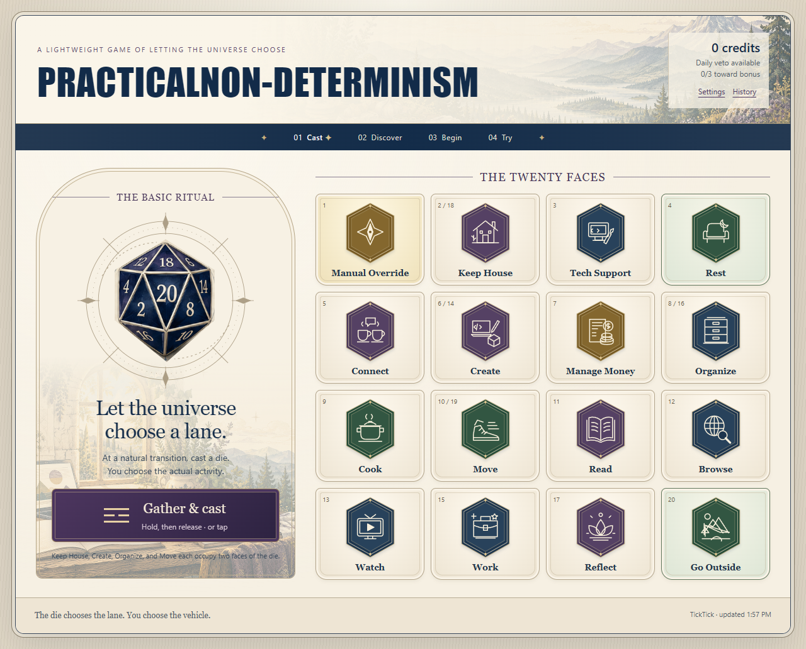

# Practical Non-Determinism

A personal decision game for natural transitions. The die chooses a lane; you choose the activity. A separate app from What Now?, based on Chris's two-page player aid.



The illustrated UI adds a maker-and-landscape backdrop, 16 category emblems, six approach symbols, a framed dice ritual, and a small landscape inside the quiet timer. Artwork provenance and the generation prompt are in [docs/ARTWORK.md](docs/ARTWORK.md).

Cast the d20, then start immediately, use a matching TickTick card, veto, or optionally cast an approach. Give the activity a little time. A quiet pool fills instead of displaying a numerical countdown. Done and the fifteen-minute deadline both record the session once.

## Current state

Version 0.2.0 is [live on GitHub Pages](https://mrsuperchris.github.io/practical-non-determinism/). Chris approved both PR merges, public source and publication on 2026-10-26. Deployment passed; all 18 published app files matched the released Git blobs. Desktop browser verification passed; physical iPad Safari verification remains an acceptance check.

## Run on this computer

No dependency installation is needed for the app, its unit tests, or packaging. Node.js 22 or newer.

```powershell
./start-preview.ps1 -Eco
```

Open `http://127.0.0.1:8896/`. `-Eco` reads the existing local SleeperService TickTick connection in memory and exposes only read-only task endpoints to this app. The browser never receives that server token. Omit `-Eco` to connect in Settings instead. Ctrl+C stops the server. This loopback URL works on this computer, not on the iPad.

Run the script from `C:/Users/Chris/claude/practical-non-determinism`; the canonical repo is on master.

## TickTick

On a hosted copy, enter a TickTick access token in Settings, or explicitly reuse this browser's Bridge connection when available on the same origin. The token stays in this browser's local storage. The app only makes GET requests; Done records game progress and **does not complete a TickTick task**.

Suggestions use category tags, configured in Settings. Up to three open cards appear: today first, then oldest due date, then undated. Cards with future start dates are omitted. Inbox and personal lists are included; Claude Queue is excluded. Settings can limit lists or change the Inbox ID. Details are refreshed when a card is chosen, with saved details available when offline.

A task carries its own instructions. Starting one discards any secondary approach; Try shows the main category and the card's description/checklist. Starting your own activity keeps an approach if you cast one.

## Local data and offline use

History, credits, preferences, active sessions and saved cards live in IndexedDB. Devices keep independent histories. Tabs on the same origin share one transactional game record. The service worker caches only app files; private task data is saved separately, never in the public app shell. History export excludes access tokens but includes selected task details.

After the first successful online visit, the shell works offline. Install on iPad with Share → Add to Home Screen. Browser storage can be cleared or evicted, so export history when it matters. A suspended or closed browser cannot execute a timer: on return, the app compares the saved deadline and records completion at that deadline, once. There is no alarm or notification.

## Verification

```powershell
npm test
```

```powershell
npm run build
```

The build copies an explicit app-file allowlist to `dist/`. See `docs/VERIFICATION.md` for browser evidence and limits. The optional Playwright harness runs against the local server with `npm run test:browser`; see that document for setup.

## Release

This repo is unlisted in Eco tiers, so tier1 rules apply: Chris explicitly approves each branch merge. Merging does not publish. After approval, enable GitHub Pages with GitHub Actions as the source and manually run **Publish app** from master. That workflow tests, packages only app files, and deploys. It refuses to deploy another branch.

The source repository is public, as approved by Chris. The live destination is [https://mrsuperchris.github.io/practical-non-determinism/](https://mrsuperchris.github.io/practical-non-determinism/). The initial [successful deployment](https://github.com/MrSuperChris/practical-non-determinism/actions/runs/40425918253) published commit `98cc71be352a40724f99b5cda58d86ef30a73ce0`.

For a release that changes app files, increment the cache version in `sw.js`. An update becomes active after the old app tabs close; it does not interrupt an active session. Check the deployed app, then update Eco's registry and Field Guide with verified live status.

## Source map

- `src/engine.mjs`: pure game rules, weighted roll, credits and deadline reconciliation.
- `src/storage.mjs`: IndexedDB transactions, including protection against duplicate completion.
- `src/tasks.mjs`: TickTick GET client, date/tag matching and saved task details.
- `src/app.mjs`: accessible DOM UI, animations, quiet timer, settings and history.
- `src/data.mjs`: editable category and approach copy; no invented music activities.
- `styles.css` / `theme.css`: responsive layout and the original player aid's visual language.
- `assets/player-aid-*.png`: original artwork extracted unmodified from the supplied PDF. Dice are framed through SVG viewports.
- `tools/serve.mjs`: loopback preview and optional local read-only Eco proxy.

The longer design record is in `docs/DESIGN.md`.
